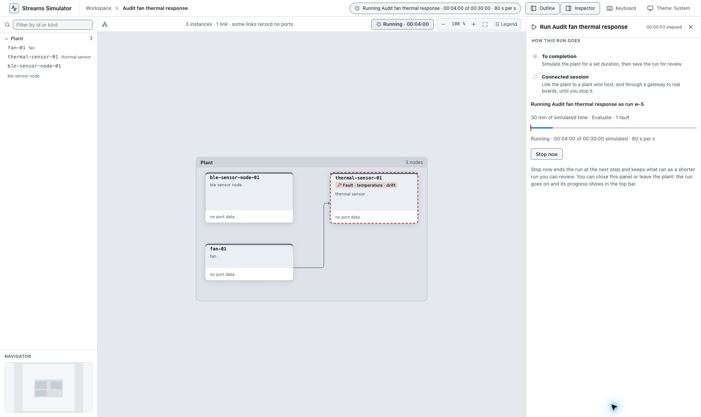

# Simulator control-plane UI audit

Reviewed in Chrome on 24 October 2026, as an IoT operations console. The UI currently works best as a plant authoring and run-review workbench. It does not yet give an operator a continuous, reliable picture of the running system, its control authority, pending decisions, and recovery state.

The most urgent findings are demonstrated behavior, not feature suggestions:

1. **Evaluate exposes injected fault names on the live plant.** Reproduced twice, including a screenshot showing Evaluate and the active fault together.
2. **Reloading an active evaluation loses control and leaves an incomplete run.** The recording remained at six simulated minutes after its expected finish time.
3. **A failed connected-session launch later looks Verified.** A zero-duration, zero-observation session displays ordinary KPI and alarm results without making the launch failure the main outcome.
4. **A running run is listed as Did not finish.** The workspace simultaneously shows its running banner and a failure-like run badge.
5. **Live diagnosis and intervention are too limited.** The tested simulation view provides fault badges and progress, but no measured values in the asset inspector, no correlated trends, and only Stop now as an execution control.

## Read the audit

- [Round 2 — Run-page improvements](round-2/README.md): the follow-up design review, focused on a natural planning, operating, and review experience; 20 improvements and proposed page layouts.
- [Findings](FINDINGS.md): 28 prioritized findings, evidence, operational impact, and concrete changes.
- [Control-plane direction](CONTROL_PLANE_DIRECTION.md): proposed operator workflows, approval design, implementation order, and acceptance exercises.
- [Review log](REVIEW_LOG.md): exact scope, setup, runs, reproduction steps, evidence index, and limitations.
- [Evidence](evidence/): Chrome screenshots and rendered-page snapshots. These are review records, not simulator fixtures or executable tests.

## What was exercised

- Reused the factory utilities plant: **23 instances, five areas, 59 links**. Ran 30 simulated minutes with a tower fan failure, compressor failure, and scheduled chiller setpoint change. The UI reported 14,490 observations and Verified replay integrity.
- Created a three-device twin through the UI. Configured a fan command to change temperature gradually. A completed Evaluate run recorded fan level 40% and temperature moving from 30 to 26 degrees Celsius.
- Tested invalid command bounds, incomplete-run recovery, navigation while running, browser reload, deliberate stop, two failed connected-session launches, board capture without an announcement, plant editing/save, device commands, twin checks, and rerun setup.

## Scope and confidence

Branch: `codex/control-plane-ui-audit-20261024`, created from freshly fetched `origin/main`, commit `3c6d78c8faa6ce86ac8119ef34d31536a9668c67`. Built the binary and UI from that checkout. Used the existing desktop Chrome viewport; did not resize it or test mobile. Read repository instructions and operating documentation, but **did not inspect implementation code**.

No physical board or working plant-wire host was connected. Successful live approval, emergency stop, reconnect, and command-effect verification remain unvalidated. Recommendations for those workflows are explicitly proposals, not claims about unseen runtime behavior. This is a browser audit, not a safety certification or a full acceptance-suite pass.

Only this documentation folder is changed. Runtime data is in the isolated temporary workspace described in the review log. No code fixes, commits, push, or publication were performed.
