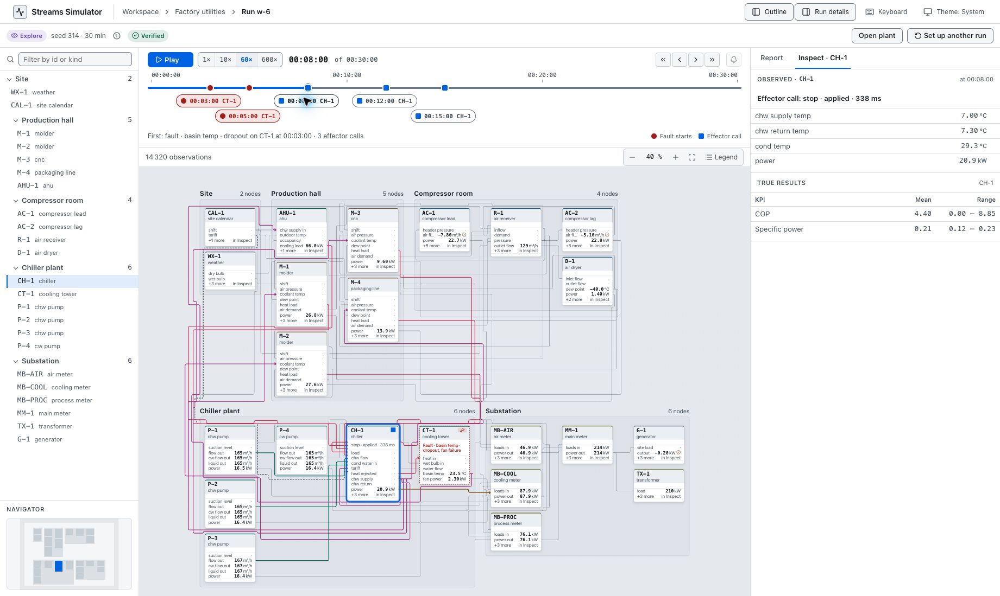

# Round 2 — Make the run page an operating workspace

The run page should carry the user through one continuous task: prepare an experiment, understand its progress, make decisions, and explain the result. The strongest improvement is to give that task a dedicated workspace, with **Plan, Live, and Review** states that preserve the same run, assets, signals, and purpose.

This round follows the owner's refined direction: **improvements rather than bug hunting, with most effort on the run page and no further concurrency checks**. It continues the desktop Chrome review without inspecting implementation code, changing screen size, or implementing UI changes.

- [Run-page improvements](RUN_PAGE_IMPROVEMENTS.md): 20 concrete improvements grounded in the operating walkthrough, with priority and acceptance criteria.
- [Proposed page design](RUN_PAGE_DESIGN.md): desktop layouts, example content, state transitions, decision/action flows, and delivery slices.
- [Walkthrough and evidence](WALKTHROUGH.md): the three factory runs, observed strengths, screenshots, and limits.

## Main recommendation

Promote running from a side-panel form into a persistent operating context. Let the primary area change with the task:

| Stage | Main area | Supporting context | Primary action |
|---|---|---|---|
| Plan | Chronological scenario and objectives | Target picker, selected-step editor, readiness | Start this plan |
| Live | Watched signals and current phase | Focused plant, event stream, decisions | Contextual operation or decision |
| Review | Outcome and aligned evidence | Phase comparison, event/action detail | Compare, repeat, or hand over |

The plant remains available throughout. Its role changes from choosing a target, to understanding impact, to explaining evidence. The user should retain the selected asset and evidence window when moving between these views.

## The experiment behind the recommendations

Reused the 23-instance factory utilities plant, seed 314, for three 30-minute Explore runs:

1. **Nominal reference (`w-8`):** no injected faults or scheduled commands.
2. **Disturbance reference (`w-7`):** tower basin-temperature dropout at minute 3; tower fan failure at minute 5.
3. **Planned response (`w-6`):** the same disturbances; stop CH-1 at minute 8, restart at minute 12, set its setpoint to 9°C at minute 15.

These are design-review exercises. The command sequence is not a recommended physical operating procedure. One seed and whole-run averages do not establish the best mitigation. The exercise shows why the UI needs explicit objectives, shared evidence windows, and complete command context.

## First improvements to deliver

1. A full run workspace with persistent identity, mode, time, purpose, and outcome.
2. A chronological plan with named phases, saved drafts, and a watch list.
3. Live observed trends, clear quality/freshness, and a Now / Next plan view.
4. An action detail panel that connects request, arguments, application, and subsequent observations.
5. A review that compares phases and reference runs against the declared objective.

This builds on working interactions: graph-assisted target selection, event-to-asset navigation, observed-at timestamps, instrument-range information, and replay verification. No implementation changes were made. The first-round findings remain in their original report; this document adds a product-design direction rather than another defect count.
