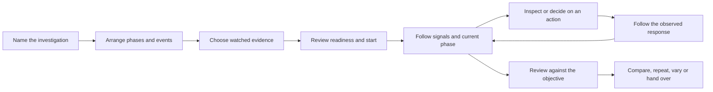

# Proposed run-page design

The design gives one run a stable workspace. The user moves between Plan, Live and Review without losing the run's identity, selected assets, watch list, evidence time or investigation goal. These are proposed layouts, not screenshots of implemented functionality.

## Stable shell

```text
Workspace / Factory utilities / Cooling loss — staged response       Run w-6
Simulation · Explore · Truth visible    [execution] [recording] [assessment]

Plan                         Live                         Review
Purpose: observe cooling response and production impact with sensor loss
```

The mode and environment remain visible when panels are closed. The status row separates execution, recording integrity and assessment. Exact plant/plan versions, seed, adapter and provenance are available through one Details action.

Use a clear distinction among these time concepts:

| Time | Meaning | Where it matters |
|---|---|---|
| Simulation time | Position in the modeled world | Plan, execution, event order |
| Elapsed wall time | How long the operation has taken for the person | Live progress and pacing |
| Evidence cursor | The instant currently being inspected | Replay and historical inspection |
| Observation time | When a displayed measurement was observed | Every latest-value display |
| Receipt time | When evidence arrived, if available | Delivery investigations and connection health |

Display exact timing provenance from the binary. Do not silently interpret board-local time as run time. Keep a Live/Replay state indicator beside the cursor and provide an explicit return-to-live action where the operating mode supports it.

## Plan state

Make the schedule the main work product. Use the plant as a target picker, with a focused model preview rather than the largest permanent surface.

```text
RUN PURPOSE AND READINESS
Cooling loss — staged response    seed 314    30 min    Explore
Investigation: cooling response, production impact, observation availability

CHRONOLOGICAL PLAN                         SELECTED STEP
00:00  Nominal operation                   15:00 · Command CH-1
03:00  CT-1 basin temperature dropout       Set setpoint
05:00  CT-1 fan failure                    Requested value: 9 °C
08:00  CH-1 stop                           Reason: [authored purpose]
12:00  CH-1 start                          Relevant observations: [chosen channels]
15:00  CH-1 setpoint → 9 °C                 [Watch response] [Edit time]
30:00  Planned end

WATCHED EVIDENCE                           MODEL / CONNECTION CONTEXT
CT-1 temperature, fan power                [Select a target in the plant]
CH-1 supply/return/cond. temperature, power Model and event capabilities
Cooling-meter power, chosen production KPI Source/version details

[Save plan] [Create reference/variant]      [Review and start this plan]
```

Phase boundaries can be anchored to plan events. Changing an event updates its phase boundary visibly. Selecting an asset can add a watched signal, a disturbance or a command while preserving the schedule position.

The selected-step editor should use typed inputs from the binary's declared contract. Show units next to fields, supported bounds, the exact target and environment, and a plain-language summary. Advanced identifiers remain copyable in Details. Keep validation close to the input and a concise readiness list near Start.

### Suggested start review

```text
Start “Cooling loss — staged response”
Simulated factory · Explore · seed 314 · 30 min
2 disturbances · 3 commands · [configured watch list]
Consumer score: not configured — investigation run
Recording: [actual readiness]
Model: [exact identity]             Plan: [exact saved revision]
[Start simulation]
```

Fields in brackets describe proposed capabilities or backend-supplied state, not observed current results. A connected session needs a separate, explicit hardware mapping and authority summary in this review.

## Live state

Promote watched evidence and current work. Preserve access to the full plant through an alternate view or focused context pane.

```text
RUN CONTEXT
Cooling loss — staged response · w-6 · Simulation · Explore
Sim 09:00 / 30:00    Wall elapsed [actual]    Rate [actual]    [run controls]

WATCHED TRENDS — SHARED TIME                 NOW / NEXT
Chiller temperatures                        Current phase: stopped
Chiller power                               Next: 12:00 · CH-1 start
Tower readings and availability             Then: 15:00 · setpoint 9 °C
Cooling meter / selected production signal  [Decision requests, when applicable]

FOCUSED COOLING SYSTEM                      SELECTED ACTION
CT-1 → CH-1 → downstream assets             08:00 · CH-1 stop
Open a neighbor or full plant               Request → application → observations
                                            [Show response window]

EVENT AND QUALITY LANES
03:00 observation loss | 05:00 disturbance | 08:00 stop | 12:00 start | 15:00 adjust
```

This is a hierarchy, not a requirement to show every section simultaneously at equal weight. The watched trends dominate. The side pane switches between Now/Next, a selected action, a selected asset and a pending decision. Its header retains the path back to the previous investigation. An event or decision opens over relevant evidence rather than navigating to an unrelated screen.

### Latest-value design

Use the tower example from the recorded run:

```text
CT-1 basin temperature
Last observed 23.5 °C · observation time 03:00
At cursor 30:00: sample age 27 min
[Quality / availability supplied by the system]   [Jump to last observation]
```

The existing observation timestamp makes this possible. The design should make age legible and the trend gap visible. Any stale classification needs the declared cadence or authoritative quality policy. Instrument range, operating limit, alarm state, and evidence availability have separate meanings.

### Action-detail design

```text
CH-1 · Set setpoint
Requested: 9 °C          Scheduled: 15:00
Source and reason: [recorded context]
Simulator application: applied · 285 ms reported latency
Evidence window: [before] → [first subsequent observation] → [selected interval]
Expected response: [declared objective or authored hypothesis]
Assessment: [met / not met / not assessable, with evidence]
[Show before and after] [Add note] [Open exact command record]
```

The command and latency come from this round's recorded exercise. Request source, rationale, linked windows and assessment are proposed additions. If exact application timestamps are unavailable, show the available timing and its limitation rather than reconstructing a precise time from an ambiguous latency field.

### Decision-detail design

For a host-backed proposed action, the same pane adds the actual proposal identity, policy/authority context, target origin, typed arguments, preconditions, expiry and evidence freshness. Approve/reject controls operate on that exact request. After the decision, the pane becomes its action history.

The empty state should say `No action requests awaiting your decision`, with a link to how command approval is configured. It should not resemble disconnected or unavailable approval support. A lease, hold, or release-next timing control is labeled by its actual semantics.

This is a proposed interaction, not a workflow validated against a live host in this round.

## Review state

Keep the run question and outcome ahead of the detailed engineering tables. Let the user select a phase or an intervention and see its evidence immediately.

```text
Cooling loss — staged response · w-6
Purpose | execution outcome | evidence coverage | integrity | objective assessment

PHASES
Nominal | Sensor unavailable | Fan failure | Stopped | Restarted | Adjusted

REFERENCE COMPARISON                         SELECTED EVENT / ACTION
Nominal w-8                                  CH-1 stop · 08:00
Disturbances w-7                             Request, arguments, application
Planned response w-6                         Subsequent observations and notes
[input differences]                          [Open response interval]

ALIGNED SIGNALS / SELECTED-PHASE RESULTS
Same channels, same units, shared cursor and selected interval
Observed evidence and its gaps; truth available under the run's visibility policy

CONCLUSIONS AND OPEN QUESTIONS
Objective results, evidence limits, authored explanation with attribution
[Compare] [Repeat complete plan] [Create variant] [Export handover]
```

### Review outcome vocabulary

| Question | Display |
|---|---|
| What ran? | Original intent, actual interval, termination reason and input identities |
| What evidence exists? | Channel/time coverage and quality, missing periods and last observations |
| Can the recording be trusted? | File/replay integrity and its exact explanation |
| What did the consumer claim? | Its verdict, evidence and scoring status, if connected |
| Did the objective hold? | Backend-assessed result, selected interval, criterion, or Not assessed |
| What did the person conclude? | Attributed notes linked to evidence, with uncertainty |

Use the planned-response example to avoid an oversimplified result. All three simulator calls applied. The shutdown interval and sensor gap still matter when interpreting the outcome. A whole-run efficiency average needs to be read alongside operating time, production and the chosen objective.

### Comparison interaction

1. Choose a reference role: nominal, disturbance-only, response, or a user-named variant.
2. Show what differs: model, seed, initial/environment conditions, disturbances, commands and duration.
3. Select an alignment: run start or a comparable event/phase.
4. Select a time window; apply it to every comparable signal and interval statistic.
5. Keep coverage and unavailable results visible. Label unmatched phases instead of silently stretching them.
6. Attach a conclusion to the chosen evidence window and export it with exact provenance.

The binary owns comparisons and assessments it defines. The UI can manage presentation, selection and authored notes through appropriate owning interfaces.

## Natural task flow



This flow keeps selection and evidence context through every transition. It also makes the human's decision and the evidence after it part of the same workflow.

## Smallest coherent delivery

### Slice 1: plan and watch one run

Deliver a dedicated run workspace, readable purpose/name, chronological plan, saved watch list, persistent run context, and basic shared observed trends. Keep detailed engineering metadata in the existing inspector. Walk through the 30-minute factory plan without using another screen to reconstruct its sequence.

### Slice 2: explain one intervention

Add selected action details, exact arguments, observation freshness, event-relative windows, phase summaries and notes. Use CH-1 stop at 08:00 and its subsequent observations. The person must be able to explain what was commanded and what evidence followed it.

### Slice 3: compare and decide

Add complete-plan repeat/variant, reference-run comparison, objective-led review and handover. Add the contextual approval pane once the owning host/session capability is available for real validation. Test that the decision remains connected to its exact request, evidence and eventual outcome.

No slice should be accepted solely because the controls render. Acceptance is completion of the operator journey with preserved context and authoritative evidence.
