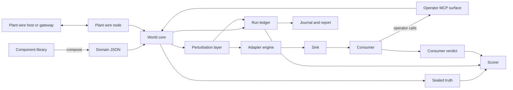

# Architecture overview

> Status: Implemented summary; release posture is conditional. Authority: current Go code and tests, with accepted deviations in `docs/DECISIONS.md`. Verified by: package map and executable dependency checks. Last verified: 2026-11-03.

Streams Simulator is a layered Go application with a browser canvas beside it. Worlds are data: a domain JSON file, or a plant composed from the component library, enters a seeded world; a delivery layer changes the observer's evidence; a data-defined adapter renders that evidence in a consumer's wire format; and a sink carries it to a consumer. The same core serves graded runs, agent and controller work, and sessions that put a real board beside simulated ones over the plant wire.

## System shape



## Modules

Every module is a public facade `internal/<m>` over private layers (`domain`, `app`, named edges); the kinds and layer rules are in the [modularity standard](../../governance/MODULARITY_STANDARD.md).

| Group | Modules | Role |
| --- | --- | --- |
| Surfaces | `cli`, `mcp`, `canvasbridge` | Flags and documents; MCP protocol; the loopback bridge the canvas talks to. Wiring and protocol only, no rule of their own. |
| Use cases | `director`, `run`, `suite`, `grading`, `report`, `release`, `refconsumer`, `plantwire`, `deviceworld` | World registry and run lifecycle (`director`); run orchestration, ledger, artifacts, replay and quiescence (`run`); suite and campaign generation (`suite`); offline grading (`grading`); run reports and comparison (`report`); the release manifest (`release`); the shipped reference consumer (`refconsumer`); the plant wire node, relay and reference host (`plantwire`); device-to-world binding (`deviceworld`). |
| Simulation cores | `world`, `perturb`, `truth`, `score`, `audit`, `lint` | Seeded world; delivery faults; sealed truth and its analytic solver; scoring policies; trivial-baseline audit; the domain plausibility check. |
| Data modules | `domain`, `component`, `adapter`, `sink`, `journal`, `device` | Domain loading and digests; the component library and `Compose`; adapters; sinks; the run journal; the device emulator. |
| Edge and foundations | `kernel`; `model`, `canonical`, `jsonschema`, `jsonvalue`, `schemas`, `randutil`, `wall` | The one operating-system edge; shared records, canonical JSON, schemas, seeded randomness and the wall-clock seam. |

`canvas/` is a separate TypeScript client (layers `model`, `app`, `adapters`, `ui`). It computes nothing the binary owns and reaches it only through the bridge; nothing in `internal/` imports it. `contracts/` holds every JSON Schema contract and the self-contained [plant wire contract](../../contracts/plant-wire/SPEC.md).

## Package direction

Each arrow is a direct import of one module's facade by another; shared foundations are omitted.

```text
cmd/streamsim → cli                    wiring only
cli → mcp, canvasbridge, report, grading, run, suite, release, refconsumer,
      plantwire, deviceworld, device, lint, component, adapter, domain
mcp → director                         protocol → world registry, run lifecycle, operator view
director → run, score, truth, audit, component, world, adapter, domain
report → grading, run, journal         grading → run, score, world, domain
run → world, perturb, adapter, sink, journal, domain
plantwire → run, truth, world, domain  deviceworld → device, world, domain
suite → audit, truth, perturb, world, domain
lint, truth, score → world, domain     world, perturb, component → domain
domain → model, jsonschema, jsonvalue, schemas, canonical
every module's file, socket and signal edge → kernel (the one OS edge)
```

`mcp` imports only `director` and foundations; `canvasbridge` imports only `kernel` and drives the binary as child processes. `plantwire` drives a `run` as a plant wire node. `deviceworld` bridges `device` and `world`, and neither core imports the bridge. `grading` composes `run` and `score`, which do not know each other. `truth` and `score` consume world evidence, never the other way round.

The complete direct-import map, each package's kind and layer, the domain-layer purity rule and the declared I/O edges are enforced by [`test/architecture`](../../test/architecture/dependencies_test.go); [the agent-facing ownership notes](../../.agents/context/architecture.md) describe each module's layers. Only module edges call `kernel`, so file permissions, atomic writes and socket ownership are decided in one place. Ledger behavior belongs to `internal/run`.

Files within a package separate loading, admission, execution, publication and related tests. Every Go file, including tests, is limited to 300 total lines. New packages require a distinct ownership boundary and a current caller; file size alone does not justify another package or Go module.

## Responsibilities

| Layer | Responsibility | Must not do |
| --- | --- | --- |
| Domain/catalog | Load, validate, digest, and describe JSON domain data. | Add a branch for a particular domain. |
| World | Advance simulation time, evolve state, inject faults, apply effectors, emit native events. | Know a consumer’s schema or interpretation. |
| Perturbation | Transform delivery and preserve a reason for each outcome. | Rewrite director-only world history. |
| Adapter | Project native events into a declared wire format. | Change scenario semantics. |
| Sink | Carry rendered records to in-process, file, or HTTP-push destinations. | Pretend external delivery is deterministic when it is not. |
| MCP | Expose catalog, world control, truth, and operator capabilities as protocol only. | Hold a rule; carry the event stream as a best-effort control push. |
| Director | Own the world registry, the run lifecycle and the operator view a token resolves to. | Speak a protocol. |
| Journal | Write the observer and director streams while a run happens. | Put a truth-bearing record in the observer stream. |
| Report / grading | Summarise a run folder; grade a finished run by replaying its artifact. | Trust a file that no digest covers. |
| Plant wire | Speak the plant wire as a node (a run) or as the reference host. | Execute a command outside the run's effector path. |
| Kernel | Touch the operating system: files, logs, sockets, signals. | Know a record, a file name or a format. |
| Run/artifact | Record commands, counts, ledger, digests, and replay inputs. | Hide incomplete or divergent runs. |
| Truth/scoring | Seal truth, accept verdicts, and compare evidence. | Reveal truth to the consumer before unblind. |
| Canvas bridge | Map each canvas action to one binary command or director tool; keep the workspace and the truth gate on run files. | Validate, compose, simulate or score anything the binary owns. |
| Component / lint | Hold the component library and compose a plant into an ordinary domain; judge a domain's plausibility. | Add a rule the `domain` module owns. |
| Device emulator | Enforce the vendored device wire contract and data-defined capability boundary. | Pretend emulator output is physical HIL evidence. |
| Device-world binding | Route accepted emulator commands to a world effector oracle. | Hide interlock or binding failures as successful execution. |

## Data, not code

Domains and adapters are data. The binary should load a new domain or adapter through the same path used by the shipped files. A new consumer should require a new adapter file and possibly an external consumer, not a new consumer-specific branch in `internal/`.

## Source authority

This page is a public summary. Current behavior is owned by the implementation and tests; accepted deviations are in [`docs/DECISIONS.md`](../../docs/DECISIONS.md). The detailed design under [`docs/design/TECHNICAL_DESIGN.md`](../../docs/design/TECHNICAL_DESIGN.md) is a status-labeled archive record, not an override of code or contracts.

## Next reads

- [Pipeline](pipeline.md)
- [Determinism](determinism.md)
- [Security model](security-model.md)
- [Invariants](invariants.md)
