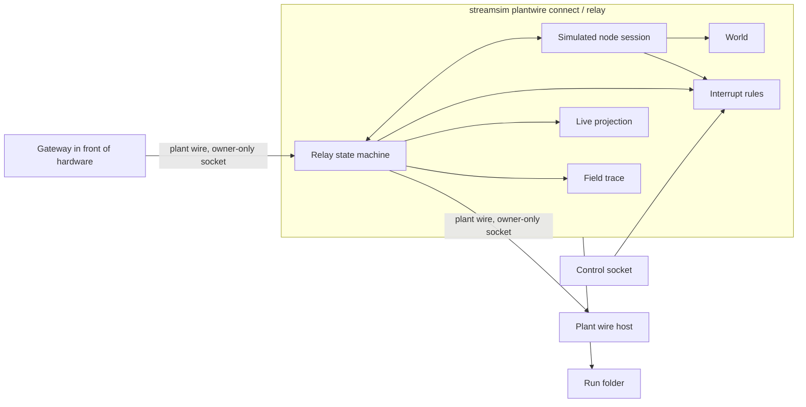

# Physical devices: architecture

> Status: Implemented. Authority: `internal/plantwire`, `internal/run`, `internal/journal`, `internal/canvasbridge`, `canvas/` and the contracts named below. Verified by: package tests, `test/architecture`, `test/contract`, and canvas end-to-end tests against the real binary with a scripted stand-in gateway. Not verified against hardware. Last verified: 2026-10-19.

This page explains how a real board is brought beside simulated ones without breaking the simulator's guarantees. For the user's path see [the guide](../guides/physical-devices.md); for exact flags and files see the [CLI](../reference/cli.md), [contract](../reference/contracts.md) and [artifact](../reference/artifacts.md) references.

The principle is that a real device is another implementation of a device the simulator already knows how to represent. A device is described once, as a plant wire **kind**. A simulated domain and a gateway in front of hardware are two implementations of it, and the binary proves the first equal to the kind file and checks that the second announces the same `kind_digest`.

## Data flow

The simulator is the gateway's host on one side and one node to the real host on the other. Records from the gateway go up and the host's commands go down with their content unchanged; the relay owns only the envelope (session id, sequence numbers, the birth's `bd_seq`). The simulated node answers commands for simulated devices exactly as `plantwire node` does, and the relay routes each command by the board that announced its device. The host sees one node.

What the relay may originate is small and fixed: a rebirth request to the gateway, an offline `STATE` to the gateway when the host is lost, a `DDEATH link_down` per device when the gateway is lost, `NDEATH` when it ends, a `not_ready` or `unknown_device` refusal for a command it cannot route, the `local_control`, `queued` and `expired` receipts of an operator's hold or approval, and, only on an operator's emergency stop, the declared safe stop of a device (the host sees no command, receipt or result for it). The interrupt rules exempt only a device's declared safe-stop command with no arguments from a hold or an approval; a safe stop with arguments is held like any command (D-100). An emergency stop reports `stopped`, `skipped` (no declared safe stop, or never born) and `unreachable` (a stop could not be ordered). It has no fault, perturbation or script option, and an architecture test keeps the perturbation, world, truth and scoring packages out of its files.

## Modules

| Module or layer | Responsibility |
| --- | --- |
| `internal/plantwire` facade | Delegates; no rule of its own. |
| `plantwire/internal/domain` | The rules, as pure state machines and functions with no clock, socket or map-order output: records, digests, sequencing, kind files and the `implements` check, kind capture from a birth, the relay (admission, routing, bindings, liveness, stops), the live projection (health, reading states, command stages), the interrupt rules (scopes, precedence, approvals, latch, replay), the policy allow-list, the session plan check, and the twin report rules. |
| `plantwire/internal/app` | One use case per command: the node session, the relay loop, `connect`, `capture`, the twin report, the control port, the interrupt log writer and verifier. It supplies records and clock readings to the domain rules. |
| `plantwire/internal/uds` | The socket edge: owner-only listeners and dialers, the gateway slot, 250 ms ticks, the control server, and the in-process link between the relay and the simulated node. |
| `plantwire/internal/host` | The reference host used by tests and the bench. |
| `plantwire/internal/files` | The file edge for kind files, run folders and host inputs. |
| `plantwire/internal/standin` | A scripted gateway for tests. A test in `test/architecture` fails any production package that imports it. |
| `internal/run` | Owns the evidence files that hold physical-session inputs: the field trace (`NewFieldTrace`, `ReadFieldTrace`), the interrupt log (`NewInterruptLog`, `ReadInterruptLog`) and their digests in the run artifact; writes the observer `wire` records. |
| `internal/journal` | The observer and director streams, including the session records (`origin`, `binding`, `session`, `live`, `interrupt`). |
| `internal/component`, `internal/domain` | The twin scaffold (`kind twin`) and the domain rules; the twin is an ordinary domain. |
| `internal/cli` | Flags, one facade call, the output document. |
| `internal/canvasbridge` | The loopback bridge: an action registry mapped to binary commands, the child process of a connected session, the control forwarder, the workspace files. It validates nothing the binary owns. |
| `canvas/` | The browser client. Layers `model`, `app`, `adapters`, `ui`; the device editor, the Connect session panel, the live review, the Interrupts region and the twin panel are modules in those layers. It decodes the binary's documents strictly and parses no message text. |

Dependencies flow downward as in the [architecture overview](overview.md). The canvas and the bridge call the binary; nothing in `internal/` imports `canvas/`.

## Records and the contract

The plant wire contract is self-contained under [`contracts/plant-wire/`](../../contracts/plant-wire/SPEC.md). The physical-device work added four things to it: a `kind_digest` for every kind in `NBIRTH` (1.1.0), an `environment` for every board and the node value `mixed` (1.2.0), an optional `command_evidence` member of `HSYNC` (1.3.0), and the board mapping schema `BOARD` with the folder's `VERSION` (1.4.0). A host and the simulator accept only the contract version and digest they were built with.

Origin is the environment of the board a device was born on; nothing else infers it. A `simulated` node can only have simulated boards, a `hardware` node only hardware boards, and a `mixed` node at least one of each. A simulated world always announces itself `simulated`; a replay of a trace does too, whatever the recording said.

## Evidence in a run folder

| File or record | Written by | Meaning |
| --- | --- | --- |
| `field-trace.jsonl` | the relay, through `run` | Every admitted gateway record in arrival order: the board's side of the session, an input of the run. |
| `interrupts.jsonl` | the node, through `run` | The inputs the interrupt rules were given and the decisions they made. |
| Observer `wire` records | the relay | Every record on both links: directions `gateway`, `node`, `host`, `relay`. |
| Observer `origin`, `binding` | the connected session | The origin of every device born to the host; the outcome of each gateway handshake. |
| Observer `session` | the connected session | The mode `connected` and the checked plan, including the sorted policy list in effect. |
| Observer `live` | the connected session | The projection: links, devices, readings with a state, the latest 128 commands with four stages, the interrupt state, and the marks since the previous snapshot. At most one per barrier or tick. |
| Observer `interrupt` | the node | The same entries as `interrupts.jsonl`, for a reopened recording. |

The `origin`, `binding`, `session`, `live` and `interrupt` records are observer session records outside the replayable stream digest.

## Determinism and replay

A run is a pure function of `(sim_version, domain_digest, adapter_digest, seed, command_log, sink)`. A session with a gateway adds one input, the field trace, so a mixed run is a function of those and of `field-trace.jsonl`; its digest is `field_trace_digest` in `run.json`. A session with a control socket adds `interrupts.jsonl` and `interrupt_log_digest`. A run without either has neither member nor file, so no existing artifact changed.

- **The simulated side** replays from the command log. Held and denied commands never reach the world and are not in the log. Approved commands and emergency stops go through the world's effector path, so they are in the log and replay with the world.
- **The board's side** is the field trace. `verify` and `replay` compare it, and `interrupts.jsonl`, with the digests in `run.json`; a different file is `matches: false` with the file named.
- **The interrupt decisions** are a pure function of the recorded inputs and the node clock readings in them. A session replays its own log through the rules when it ends and leaves the digest out of `run.json` if the log does not replay; the file is then renamed `interrupts.rejected.jsonl`. Records of the node's own stops' effects are evidence, not replayed.
- **`replay-trace`** plays the trace to a host as a simulated node. Its stream is a pure function of the trace and the host's answers.
- **The twin report** is a pure function of the run folder, the domain, the kind files and its options. It uses no wall clock and no random number.
- **Outside the digest.** `live`, `session`, `origin`, `binding` and `interrupt` records are written while the session runs from what the host saw; a replay does not regenerate them, and nothing stops an edit to them before the journal's digest is taken. They describe the session; they determine no outcome. The policy list is recorded there and is not a replay input, because only a command that passed the node's checks enters the command log.

## Truth boundary

- A simulated device keeps sealed, generative truth. Nothing the relay or the interrupts do reveals it, and the director stream is not readable by the canvas until the run ends.
- A hardware device has no truth. A hardware-only relay's director stream holds only its closing record. A `DRESULT` from a board is self-reported (`reported_outcome`). The effect stage is `observed` only when the host's `command_evidence` names the same command, device and boot, follows an accepted command whose board reported success on the device's current boot, and lies within its stated tolerance of its expectation; the relay also compares it with the reading it holds and records a disagreement as unverified. The host's check of a reading the board itself reported is recorded evidence, not independent proof of a physical effect.
- The twin report and the live view read the observer journal, the field trace and the interrupt log only. They never read sealed files.
- The plausibility bounds of a real reading come from the gateway's own birth. A hostile gateway sets its own bounds; the view shows what the gateway declared, not what is true.

## Bridge actions

The bridge maps each canvas action to one binary command and holds no rule. The actions used by physical devices:

| Action | Runs | Notes |
| --- | --- | --- |
| `kind.validate`, `kind.check` | `kind validate` (a workspace file; or `--stdin [--twin]`, a dry run that writes nothing) | Issues are relayed unchanged. |
| `kind.suggest`, `kind.twin` | `kind twin --suggest`; `kind twin --choices ... --out ...` | The kinds are passed by stem; `kind.twin` writes the domain, guarded by the file's version. |
| `kind.capture` | `kind capture` | Takes pasted text or a run's observer journal, never the sealed one. |
| `component.validate`, `domain.validate` | `component validate`, `domain validate --kinds-dir` | Workspace `kinds/` and `components/` are passed automatically. |
| `domain.assumptions`, `domain.lineage` | `domain assumptions <domain> [--twin <choices>]`; `domain lineage --domains-dir ...` | Read-only. What a twin or domain assumes and does not model; how each plant is produced (composition or twin), which twins include a device kind file, which runs used an older version of a plant, and the edit route. The bridge passes the workspace folders that exist. |
| `domain.diff` | `domain diff <a> <b>` | Read-only. What differs between two domains, each a workspace domain file or a run id (read from `run.json` only): per kind the readings, dynamics, commands, faults and states that changed, the instances and relations they reach, and whether the model changed under an unchanged version. |
| `session.check` | `plantwire connect --check --stdin` | The plan travels on standard input. |
| `session.start` | `plantwire connect --stdin --out runs/c-<8 hex> --control-socket <path>` | A lasting child the bridge owns, in its own process group; one at a time; the plan is checked first. |
| `session.status`, `session.stop` | none; interrupt then wait up to 30 s, then kill | `status` never waits; it reports `controls` while the control socket exists. |
| `session.control` | forwards one `node-control-v0.1` request to the socket | At most 4096 bytes, one reply line, 12 s wait; the reply is returned unchanged. A node refusal is a reply, not a bridge error. |
| `run.twin_report` | `plantwire twin-report` | `{run, domain, tolerance?, span_fraction?}`. |

The policy default is not an action. `settings/default.policies.json` is the one file of `settings/`, read and written through the bridge's file routes (atomic, owner-only, guarded by the file version), checked only for its path and size by the bridge and for its digests by the binary when a plan is checked. It is never passed to a command.

## Next reads

- [Guide: a real board beside simulated ones](../guides/physical-devices.md)
- [Security model](security-model.md)
- [Determinism](determinism.md)
- [Truth and scoring](truth-and-scoring.md)
- [Limitations: physical devices](../limitations.md#physical-devices)
