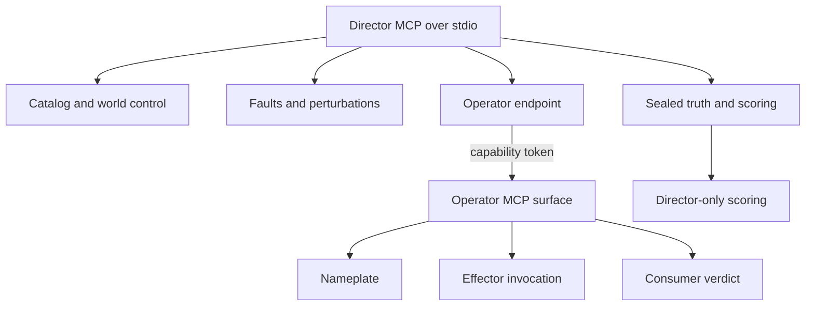

# Security and trust boundaries

> Status: Implemented local trust model. Authority: MCP role wiring, capability checks, contracts, and security policy. Verified by: MCP strictness/operator tests and repository review. Last verified: 2026-08-17.

Streams Simulator is a local test instrument, not a hosted multi-tenant service. Its security model is about preventing the simulator from helping a consumer cheat, preventing producer text from becoming control input, and making capability boundaries explicit.

## Role separation

The director manages the experiment and owns the oracle. The operator endpoint is what a consumer receives for a world: nameplate, effector list, effector invocation, and verdict submission. `streamsim mcp --role operator` is not a standalone server; the operator surface is served by a director process when `--operator-addr` is supplied.

## Capability tokens

`sim.world.create` returns the operator endpoint and a capability token for that world. Operator calls require the token. The token scopes access to the world and is separate from the command id used for effector idempotency.

Do not put tokens, credentials, or private receiver URLs into committed domains, adapters, examples, artifacts, or issue reports.

## Injection boundary

Producer-controlled strings can appear in event fields and other admitted free-text channels. The injection probe runs benign and adversarial variants and compares the consumer-visible evidence and conclusion. A text change must not change control-plane truth, ledger evidence, or the consumer’s conclusion byte-for-byte where the probe requires it.

## Transport boundary

MCP carries control, actuation, and audit requests. Evidence leaves through the declared sink. This avoids using best-effort control-plane delivery as the benchmark’s event transport and keeps the absence signal measurable.

## Physical devices and the control socket

Status: implemented for a local bench; not a multi-user or networked design. See [the architecture](physical-devices.md) and [the guide](../guides/physical-devices.md).

- **Plant wire sockets.** The plant wire has no authentication. A listener creates its socket in a directory that is owned by the user and closed to group and others (a missing directory is created `0700`; any other is refused), and a dialer, including a node, the relay and the control client, refuses a socket or directory that is not owned by the user or that group or others can reach. A live socket or a regular file at a path is never replaced. Access control is the directory.
- **Control socket.** `plantwire connect --control-socket` creates its socket the same way, takes at most 8 connections, reads lines of at most 4096 bytes and closes a connection idle for 60 seconds. The binary validates every request against `node-control-v0.1`. There is no authentication beyond the directory: any process of the same user can hold, approve or stop the node, and the interrupt log records no operator identity. The emergency stop is one press, by design.
- **Bridge.** The canvas bridge listens on a loopback address and serves plain HTTP. A browser pairs once with a code printed on the bridge's standard error (five wrong codes lock pairing) and then holds an `HttpOnly`, `SameSite=Strict` cookie; every request is checked for the bridge's host, its origin and a same-origin fetch. Any paired browser of the bridge's user can send a control. The bridge makes the control socket's directory owner-only, under the temporary directory (or `/tmp` when the path would be too long for a Unix socket), and starts a session without controls when it cannot.
- **What the node may do.** It only refuses or stops. It never originates an ordinary command, changes a forwarded command, or widens what the host may do. Replay, `verify`, `run`, `scenario` and `plantwire node` have no gateway option, so a recording can never reach hardware. The firmware's own leases and safe state remain the last line of defence if the simulator stops.
- **Policy digest.** A command's `policy_digest` is a label the host copies into each command. The session's allow-list protects a bench against a host acting under a policy it was not set up for. It is an authorisation gate, not authentication and not a signature, and does not protect against a hostile process that can reach the socket. The simulator never creates or widens a policy, nothing is added to a list automatically, and a saved default only pre-fills a new draft. A real board's list belongs to the gateway.
- **Untrusted gateway.** Every record is checked against its schema and size limit before it is carried; a duplicate, a record of another session, a forged answer (a side answering a command routed to the other) and a device born on the wrong board are dropped and counted. Its reading bounds and `kind_digest` are its own claims: the view shows what the gateway declared, and a capture drafts from a claim for a person to review.
- **Data.** A workspace and its run folders hold what the board reported. Keep them outside the repository when they hold customer data.

Known limits are on the [limitations page](../limitations.md#physical-devices).

## Local operational security

- Run artifacts and ledger files may contain sensitive test data; choose permissions and output directories accordingly.
- HTTP-push sends data to the configured receiver; treat the URL as an explicit egress decision.
- Validate untrusted JSON through the contract before using it as a domain, adapter, verdict, or label.
- Keep the existing [`SECURITY.md`](../../SECURITY.md) policy and CI security checks in force.

## Next reads

- [MCP reference](../reference/mcp.md)
- [Invariants](invariants.md)
- [Security policy](../../SECURITY.md)
