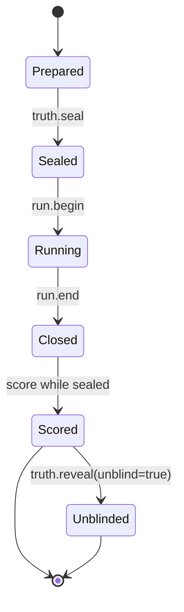

# Truth, verdicts, and scoring

> Status: Implemented; release evidence remains conditional. Authority: `internal/truth`, `internal/score`, MCP handlers, and versioned schemas. Verified by: truth, scoring, MCP and online/offline parity tests. Last verified: 2026-11-03.

The simulator’s oracle must be stronger than the consumer it evaluates. Truth is therefore created and held on the director side, while the consumer sees only the operator surface and the delivered stream.

## Lifecycle

The intended sequence is: install truth, seal it, run the world, accept the consumer verdict, close the run, score while truth remains sealed, and only then reveal/unblind for post-hoc inspection. The implementation refuses scoring after an unblind stamp. The caller must also enforce the close-before-score sequence; the current score handler does not independently assert the run-ended flag. The exact tool preconditions are part of the MCP surface and schemas.

## What scoring can distinguish

- A world event that was never delivered is a transport miss, not automatically a consumer reasoning miss.
- A delivered event that the consumer misinterprets is a reasoning miss.
- An effector acknowledgement without a resulting state change is not a successful action outcome.
- An incomplete run or missing evidence must fail closed rather than become a zero-error score.
- A trivial detector that wins because the scenario leaks its label is a suite-design failure; the scenario should be audited before it enters a graded set.

## Verdicts and labels

The consumer verdict and ground-truth record are validated against the versioned contracts under [`contracts/`](../../contracts/). The offline CLI score path reads `verdict.json` and `label.json` (or `labels.json`, one label per disturbance of a run that carries none or several) beside the run artifact unless a label path is supplied with `--label`. A run with several labels prints one scorecard per label, each judged on its own entity, plus what the consumer reported on entities without a label. A label is keyed by entity and fault (O25): with several labels on one entity, a detection is judged with the label whose fault it names, and a call with the labels that expect it; what names or is expected by none of them is judged with each.

A detection before its label's first observable time is `suspicious` (too early), not detected. An instrument fault
that drops a reading, or holds it (`stuck` or `freeze`) on a channel with noise, is first observable at its injection: the
channel stops delivering or stops moving at once, so a consumer that reports it from that is graded on its lead from the
injection.

### Failure predictions

A detection may carry `predicted_failure_at` (consumer-verdict v0.1, optional): when, at `detected_at`, the consumer
expects the entity to fail if nobody acts. `streamsim score` grades predictions against truth it computes, not a sealed
file: when the verdict carries one, the run is replayed with every effector call removed (the `do_nothing` outcome run of
`streamsim outcome`), and the true failure time t_f of a label's entity is its first protection trip there. Once anyone
acts the real failure moves, so a prediction is graded only when made at or after the label's first observable time and
before both t_f and the run's first effector call that took effect (PLAN.md section 8.2, L6). A scorecard's `judgment`
then holds `prognosis` (absent when there is nothing to grade, so earlier documents are unchanged):

| Member | Meaning |
| --- | --- |
| `failure_ns`, `graded_until_ns` | t_f, and the end of the graded window (t_f or the first effective call, whichever comes first) |
| `predictions` | predictions graded |
| `alpha`, `beta`, `late_weight` | 0.2, 0.5, 2 |
| `horizon_ns` | prognostic horizon PH = t_f − t_i, t_i the earliest graded prediction from which every later one is inside ±α; absent when the last one is outside |
| `lambdas[]` | for λ 0.5 and 0.75: `at_ns` = t_P + λ(t_f − t_P), t_P the first graded prediction; `graded` when that point precedes the window's end; then `alpha_lambda` (the prediction in force there is inside ±α) and `relative_accuracy` RA = 1 − e |

The error of a prediction of failure time p, evaluated at time t, is e = w·|p − t_f| / (t_f − t), that is |RÛL − RUL*| /
RUL*, with w = 2 when p is after t_f (late) and 1 otherwise. Inside ±α means e ≤ α; a point prediction's probability mass is
all inside or all outside, so β is met exactly when it is inside. Each prediction counts for PH at the time it was made; at a
λ point the latest prediction made at or before it is evaluated there. The director's online scorer has no outcome replay
and grades no prediction.

The score is meaningful only with the exact run artifact, ledger, truth label, simulator version, domain/adapter digests, and consumer inputs that produced it. A score copied without those inputs is not an auditable benchmark result.

## Outcomes

`streamsim outcome` grades a run on its consequences: trips, boundary violations, KPI changes and unneeded calls, each
priced by the domain's `ground_truth.outcome_weights`, against doing nothing and against the domain's fixed
`baseline_policies`. The outcome reference is computed at scoring time, not sealed (owner decision O15): the run's own
artifact is replayed with every effector call removed, and again with each baseline policy played instead. That reference
is a pure function of inputs fixed before the run (domain, seed, planned faults), the consumer cannot influence it, and it
never exists while the consumer runs, so one path serves scripted, plant wire and director runs. The world records the
outcome exactly, at the step where a trip or boundary changes, only when an outcome replay asks for it; ordinary runs are
unchanged. The run is replayed first and refused if it does not reproduce or is stamped unblinded, as `score` refuses. A story is
`valid` when doing nothing is not clean, and `easy` when it is valid and some baseline policy ties or beats the run: a
fixed rule does as well, so the story does not separate a controller from it.
Implemented in [`internal/run/`](../../internal/run/) (`ReplayOutcome`), [`internal/score/`](../../internal/score/)
(cost and verdicts) and [`internal/grading/`](../../internal/grading/) (`GradeOutcome`).

## Hardware devices have no truth

Sealed truth and scoring apply to simulated devices. A real board announced through a gateway has no generative truth: its readings are what it reported, and a `DRESULT` is self-reported and may be wrong. The simulator does not score a consumer against a board's self-reports. A physical effect counts only when an independent instrument observes it, and the host's own check of a reading the board itself reported is recorded evidence, not independent proof. The twin report compares a twin with a board's readings; it measures the twin, not a consumer. See [physical devices: truth boundary](physical-devices.md#truth-boundary).

## Implementation evidence

The scoring bundle `scorecard-bundle-v0.2` uses shared online/offline policies for judgment, delivery admission, evidence grounding and action fidelity. Judgment selects the earliest detection regardless of verdict ordering. Identity-conflict handling requires a reported conflict admission when identity reuse applies; appropriate-action credit requires the scenario entity, or one of the instances and effectors the label's `expected_actions` name; action fidelity matches a verdict action to the world's call by command id, effector and entity, and does not require the action's `issued_at` to follow the call. Malformed citations fail grounding in both paths. Online resolution and deadline metrics still require world history and are not inferred by the offline path. An unavailable offline ledger produces conservative zero metrics; an available empty ledger retains the existing vacuous-success convention. These metric corrections retain the JSON field layout.

Truth lifecycle behavior is implemented in [`internal/truth/`](../../internal/truth/) and held by [`internal/director/`](../../internal/director/) and exposed through [`internal/mcp/`](../../internal/mcp/). Scoring is implemented in [`internal/score/`](../../internal/score/); the offline path (`streamsim score`) is [`internal/grading/`](../../internal/grading/), which replays the run artifact for its effector calls and scores with `score`. Parity is covered by the [online/offline parity regressions](../../internal/score/internal/domain/shared_policy_test.go). Local test evidence and remaining release risks are recorded in the [refactoring review](../../docs/refactoring/clean-code-20261002/REVIEW.md); passing tests do not establish complete offline evidence validation or release readiness.

## Next reads

- [MCP reference](../reference/mcp.md)
- [Benchmark methodology](../benchmark/methodology.md)
- [Artifact reference](../reference/artifacts.md)
